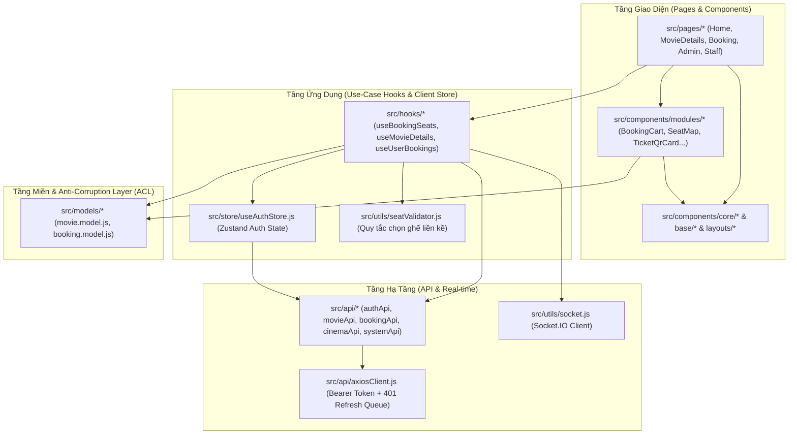

# GzaCinema Client — Hệ Thống Đặt Vé Xem Phim Trực Tuyến

Ứng dụng Frontend cho nền tảng đặt vé điện ảnh **GzaCinema**, được xây dựng theo kiến trúc phân lớp hiện đại với **React 18**, **Vite 5**, **Tailwind CSS**, **TanStack Query v5**, **Zustand** và **Socket.IO**.

---

## 1. Tổng Quan & Ma Trận Tính Năng

GzaCinema Client cung cấp giao diện trải nghiệm điện ảnh tối ưu cho 3 nhóm vai trò người dùng:

| Phân hệ | Đối tượng | Tính năng cốt lõi |
| :--- | :--- | :--- |
| **Khách hàng (Customer)** | Người xem phim | • Duyệt phim theo trạng thái **Đang chiếu** / **Sắp chiếu**, tìm kiếm & lọc nhanh.<br>• Xem chi tiết phim, trailer YouTube nhúng và lịch chiếu theo cụm rạp / ngày.<br>• Sơ đồ ghế thời gian thực (Socket.IO): giữ ghế / bỏ giữ ghế tức thì, kiểm tra quy tắc không để trống 1 ghế lẻ (`seatValidator`).<br>• Hỗ trợ đa loại ghế: **Thường**, **VIP** (+20.000₫), **Sweetbox Đôi** (+50.000₫/ghế, tự động chọn theo cặp).<br>• Đồng hồ đếm ngược giữ ghế 5 phút đồng bộ theo từng suất chiếu.<br>• Thanh toán trực tuyến qua cổng **VNPay** và tra cứu vé điện tử kèm mã **QR Code**.<br>• Quản lý hồ sơ cá nhân và bảo mật mật khẩu. |
| **Nhân viên (Staff)** | Nhân viên soát vé | • Bàn soát vé chuyên dụng tại `/admin/checkin` (hỗ trợ cả camera quét QR trực tiếp qua `@yudiel/react-qr-scanner` và nhập mã vé thủ công).<br>• Xác thực trạng thái vé tức thời và ghi nhận lịch sử quét trong phiên làm việc. |
| **Quản trị viên (Admin)** | Quản lý hệ thống | • **Dashboard phân tích**: KPI doanh thu, tổng vé bán, giá vé trung bình, bảng xếp hạng doanh thu theo phim và tỷ trọng Top 5.<br>• **Quản lý Phim**: Thêm/sửa/xóa phim, tải lên poster và cấu hình trailer.<br>• **Quản lý Cụm rạp & Phòng chiếu**: Thiết lập danh sách rạp, cấu hình phòng chiếu và ma trận ghế tự động.<br>• **Quản lý Suất chiếu**: Lên lịch chiếu theo phim/rạp/phòng, tự động kiểm tra xung đột thời gian.<br>• **Quản lý Đơn đặt vé**: Tra cứu hóa đơn, lọc theo trạng thái, xem danh sách QR từng vé và hỗ trợ check-in trực tiếp. |

---

## 2. Công Nghệ Sử Dụng & Kiến Trúc Frontend

### 2.1. Tech Stack

- **Core & Bundler**: React 18, Vite 5, React Router DOM v6 (Code-splitting với `React.lazy` & `Suspense`).
- **Quản lý trạng thái**:
  - **Server State**: `@tanstack/react-query` v5 (caching, `keepPreviousData`, optimistic updates kết hợp Socket.IO).
  - **Client State**: `zustand` v5 (quản lý phiên đăng nhập `useAuthStore` tích hợp Redux DevTools).
- **HTTP & Real-time**: `axios` (Request/Response Interceptors + hàng đợi tự động làm mới Access Token khi gặp lỗi `401`), `socket.io-client` v4.
- **Form & Validation**: `react-hook-form` v7, `zod` v4, `@hookform/resolvers`.
- **UI & Tiện ích**: Tailwind CSS v3, `lucide-react`, `react-hot-toast`, `qrcode.react`, `@yudiel/react-qr-scanner`, `react-helmet-async`.

### 2.2. Sơ Đồ Kiến Trúc Phân Lớp



### 2.3. Các Nguyên Tắc Thiết Kế Chính

1. **Anti-Corruption Layer (`src/models/*`)**:
   - Mọi dữ liệu thô (DTO) trả về từ Backend đều đi qua các hàm mapper thuần khiết (`mapMovieDtoToEntity`, `mapShowtimeGroupDtoToEntity`, `mapBookingDtoToEntity`, `mapTicketDtoToEntity`) trước khi vào UI.
   - Tập trung hóa các hằng số và quy tắc tính giá miền nghiệp vụ (`SEAT_SURCHARGE`, `SEAT_TYPE_LABEL`, `calculateSeatPrice`, `TICKET_STATUS_CONFIG`) tại `booking.model.js`.
2. **Use-Case Hooks (`src/hooks/*`)**:
   - Đóng gói toàn bộ luồng nghiệp vụ phức tạp (ví dụ `useBookingSeats` quản lý đồng thời: truy vấn sơ đồ ghế, kết nối phòng Socket.IO, khôi phục ghế đang giữ, kiểm tra ghế trống lẻ và tạo giao dịch thanh toán).
3. **Cơ Chế Tự Động Refresh Token Hàng Đợi (`src/api/axiosClient.js`)**:
   - Khi nhiều request đồng thời nhận mã lỗi `401 Unauthorized`, chỉ một request gọi `/auth/refresh`; các request còn lại được đưa vào `failedQueue` và tự động thực thi lại ngay khi có Access Token mới.
4. **Phân Cấp Component Rõ Ràng (`src/components/*`)**:
   - `core/`: Các nguyên tử UI tái sử dụng cao (`Button`, `Input`, `Select`, `DatePicker`, `Modal`, `Badge`, `DataTable`, `MoneyInput`).
   - `base/`: Các thành phần hạ tầng ứng dụng (`ErrorBoundary`, `LazyLoading`, `ScrollToTop`).
   - `layouts/`: Khung bố cục chung (`Navbar`, `Sidebar`, `Footer`, `Breadcrumb`).
   - `home/` & `modules/`: Các khối giao diện gắn với từng miền nghiệp vụ (`booking`, `movie`, `history`, `profile`, `auth`).

---

## 3. Cấu Trúc Thư Mục

```text
src/
├── api/                  # Cấu hình axiosClient (401 Queue Interceptor) & các module gọi API
│   ├── axiosClient.js
│   ├── authApi.js
│   ├── bookingApi.js
│   ├── cinemaApi.js
│   ├── movieApi.js
│   └── systemApi.js
├── app/                  # Khởi tạo App shell và cấu hình định tuyến tập trung
│   ├── App.jsx
│   └── router.jsx
├── components/           # Hệ thống Component phân lớp
│   ├── base/             # ErrorBoundary, LazyLoading, ScrollToTop
│   ├── core/             # Button, Badge, Card, DataTable, DatePicker, Input, Modal, Select...
│   ├── home/             # HeroBannerSlider, MovieTabSection
│   ├── layouts/          # Navbar, Sidebar, Footer, Breadcrumb
│   └── modules/          # auth, booking, history, movie, profile
├── hooks/                # Custom Use-Case Hooks (useBookingSeats, useMovieDetails, useUserBookings)
├── models/               # Anti-Corruption Layer Mappers & Domain Logic (booking.model.js, movie.model.js)
├── pages/                # Các trang theo từng phân hệ
│   ├── admin/            # AdminLayout, AdminDashboard, AdminMovies, AdminShowtimes, AdminCinemas, AdminRooms, AdminBookings
│   ├── auth/             # Login, Register
│   ├── booking/          # Trang chọn ghế & thanh toán
│   ├── history/          # Lịch sử đặt vé & QR Code
│   ├── home/             # Trang chủ
│   ├── movie/            # Chi tiết phim & chọn suất chiếu
│   ├── not-found/        # Trang 404
│   ├── payment/          # Trang kết quả callback thanh toán VNPay
│   ├── profile/          # Quản lý thông tin cá nhân
│   └── staff/            # Bàn soát vé QR (StaffCheckIn)
├── store/                # Zustand store quản lý xác thực (useAuthStore.js)
├── styles/               # Global CSS bổ trợ
├── utils/                # Tiện ích định dạng (formatters.js), kiểm tra ghế (seatValidator.js), Socket.IO (socket.js)
├── index.css             # Cấu hình Tailwind CSS & biến màu chủ đề Cinema
└── main.jsx              # Điểm khởi chạy ứng dụng & QueryClientProvider
```

---

## 4. Luồng Đặt Vé Thời Gian Thực & Thanh Toán VNPay

1. **Khởi tạo phiên chọn ghế**:
   - Khi người dùng truy cập `/booking/:showtimeId`, hook `useBookingSeats` tải sơ đồ ghế qua `bookingApi.getSeats(showtimeId)` và mở kết nối Socket.IO phát sự kiện `join_showtime`.
   - Nếu người dùng có ghế đang giữ từ trước (`status === 'held_by_me'`), hệ thống tự động khôi phục danh sách ghế và bộ đếm ngược 5 phút từ `localStorage`.
2. **Giữ ghế & Kiểm tra quy tắc ghế liền kề**:
   - Khi chọn hoặc bỏ chọn ghế (tự động ghép cặp đối với ghế `sweetbox`), `seatValidator.js` kiểm tra quy tắc không để trống 1 ghế lẻ ở giữa hoặc ở bìa dãy ghế.
   - Gọi API `/bookings/hold` hoặc `/bookings/unhold`, cập nhật lạc quan (Optimistic Update) vào cache của React Query.
   - Mọi thay đổi từ các khách hàng khác trong cùng suất chiếu được đồng bộ tức thời qua sự kiện `seat_status_changed`.
3. **Thanh toán qua VNPay**:
   - Khi nhấn **Tiến Hành Thanh Toán**, client kiểm tra tính liên thông của các ghế đã chọn (`areSeatsConnected`), sau đó gọi `/bookings/create-payment-url`.
   - Kiểm tra tính an toàn của URL thanh toán và chuyển hướng trình duyệt sang cổng VNPay.
   - Sau khi giao dịch hoàn tất, VNPay chuyển hướng người dùng về `/payment/success` để hiển thị trạng thái xác nhận đơn vé.

---

## 5. Phân Quyền & Định Tuyến (Routing & RBAC)

Hệ thống định tuyến trong `src/app/router.jsx` áp dụng cơ chế bảo vệ đa tầng thông qua `ProtectedRoute` và `RoleRoute`:

| Đường dẫn (Path) | Component | Layout / Guard | Quyền truy cập | Mô tả |
| :--- | :--- | :--- | :--- | :--- |
| `/` | `Home` | `PublicLayout` | Công khai | Trang chủ, banner phim nổi bật và danh sách phim |
| `/movie/:id` | `MovieDetails` | `PublicLayout` | Công khai | Thông tin phim, trailer và lịch chiếu theo rạp |
| `/login`, `/register` | `Login`, `Register` | `PublicLayout` | Công khai | Đăng nhập và đăng ký tài khoản |
| `/booking/:showtimeId` | `Booking` | `ProtectedRoute` | Đã đăng nhập | Sơ đồ chọn ghế thời gian thực và thanh toán |
| `/payment/success` | `PaymentResult` | `ProtectedRoute` | Đã đăng nhập | Kết quả phản hồi từ cổng thanh toán VNPay |
| `/history` | `History` | `ProtectedRoute` | Đã đăng nhập | Lịch sử giao dịch và mã vé QR Code |
| `/profile` | `Profile` | `ProtectedRoute` | Đã đăng nhập | Cập nhật hồ sơ cá nhân & đổi mật khẩu |
| `/admin/checkin` | `StaffCheckIn` | `RoleRoute` (`admin`, `staff`) | `admin`, `staff` | Bàn soát vé QR Code bằng camera hoặc mã định danh |
| `/staff/checkin` | `Navigate` | Redirect | `admin`, `staff` | Tự động chuyển hướng về `/admin/checkin` |
| `/admin` | `AdminDashboard` | `RoleRoute` (`admin`) | Chỉ `admin` | Thống kê doanh thu, vé bán và hiệu suất phim |
| `/admin/movies` | `AdminMovies` | `RoleRoute` (`admin`) | Chỉ `admin` | Quản lý danh mục phim điện ảnh |
| `/admin/movies/:id/showtimes` | `AdminMovieShowtimes` | `RoleRoute` (`admin`) | Chỉ `admin` | Quản lý suất chiếu theo từng bộ phim |
| `/admin/showtimes` | `AdminShowtimes` | `RoleRoute` (`admin`) | Chỉ `admin` | Quản lý toàn bộ lịch chiếu hệ thống |
| `/admin/cinemas` | `AdminCinemas` | `RoleRoute` (`admin`) | Chỉ `admin` | Quản lý danh sách cụm rạp |
| `/admin/cinemas/:cinemaId/rooms` | `AdminRooms` | `RoleRoute` (`admin`) | Chỉ `admin` | Quản lý phòng chiếu theo từng cụm rạp |
| `/admin/bookings` | `AdminBookings` | `RoleRoute` (`admin`) | Chỉ `admin` | Quản lý hóa đơn đặt vé và hỗ trợ check-in |

---

## 6. Cài Đặt, Biến Môi Trường & Scripts

### 6.1. Yêu Cầu Hệ Thống
- **Node.js**: `>= 18.x`
- **npm**: `>= 9.x`

### 6.2. Cấu Hình Biến Môi Trường
Tạo file `.env` tại thư mục gốc `gzacinema-client/`:

```env
VITE_API_URL=http://localhost:5000/api
```

- `VITE_API_URL`: Đường dẫn gốc tới Backend REST API.
- **Lưu ý về Socket.IO**: Module `src/utils/socket.js` tự động loại bỏ hậu tố `/api` từ `VITE_API_URL` để thiết lập kết nối WebSocket trực tiếp tới origin của Backend Server (mặc định `http://localhost:5000`).

### 6.3. Các Lệnh Thực Thi (Scripts)

```bash
# Cài đặt dependencies
npm install

# Khởi chạy máy chủ phát triển (mặc định tại http://localhost:5173)
npm run dev

# Kiểm tra chất lượng mã nguồn với ESLint
npm run lint

# Đóng gói bản dựng Production vào thư mục dist/
npm run build

# Xem trước bản dựng Production tại máy cục bộ
npm run preview
```
